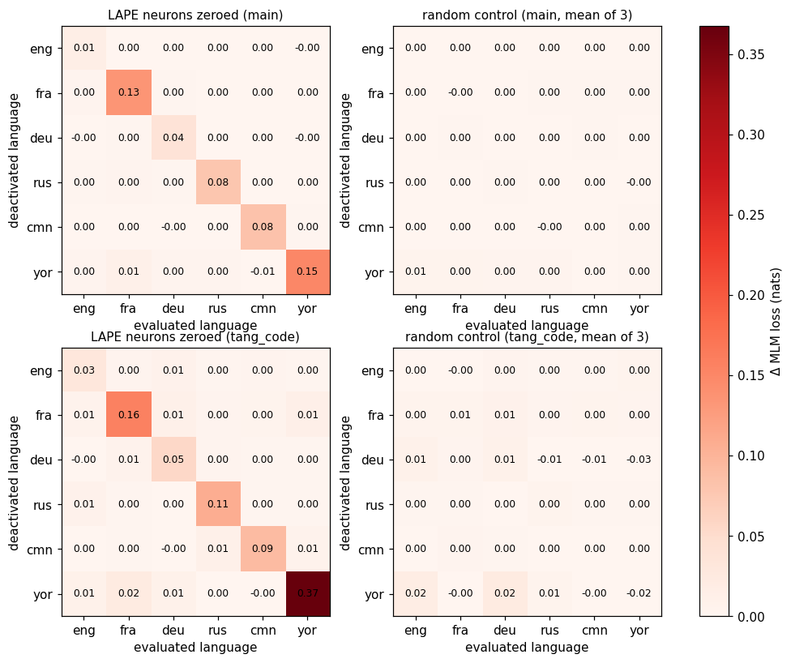

# Language-specific neurons in mBERT

Do multilingual models have neurons that serve one language? This project re-implements **LAPE** (Language Activation Probability Entropy, Tang et al., 2024) on `bert-base-multilingual-cased` and tests the selected neurons causally.

Lab 2 of the M2 Computational Linguistics programme, Université Paris Cité.

## What it does

- Computes, for every FFN neuron and language, the share of tokens on which the neuron is active (FLORES+ dev split), and selects low-entropy, language-specific neurons.
- **Causal test:** zeroes the neurons of one language and measures the effect on every language, against a layer-matched random control and a stricter control of neurons that are equally active but not language-specific.
- Inspects what the neurons respond to (top-activating tokens, subword pieces) and how much of their output weight lies in the subspace spanned by the language means.
- **Bonus with Kazakh** (`kaz_Cyrl`), which shares the Cyrillic script with Russian: are the Kazakh and Russian neurons separable?

## Files

- `language_neurons_mbert.ipynb`: notebook with all outputs (Google Colab, GPU).
- `language_neurons_mbert.py`: the same code as a script.
- `results/`: cached tables (`*.csv`), arrays (`*.npy`) and figures; the notebook reloads them instead of recomputing.

## Run it

Python ≥ 3.10 with `torch`, `transformers`, `datasets`, `numpy`, `scipy`, `pandas`, `matplotlib`.
FLORES+ is gated on Hugging Face: accept its conditions and log in before running. The data are not included (evaluation-only licence).
